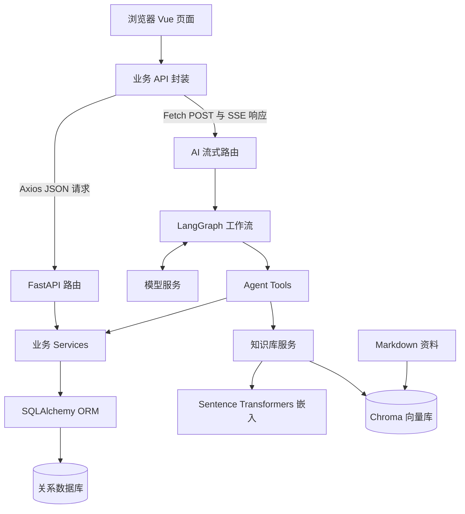

# LabAgent 项目架构与实现详解

> 编写日期：2026-10-26。依据当前项目源码、依赖声明、本地已安装 Chroma 源码及只读检查的向量库配置整理。
>
> 本文区分“当前实现”“选型分析”和“改进建议”。选型分析解释这些技术为何适合本项目，并不代表仓库记录了作者最初的决策过程。本次没有启动业务数据库、调用模型服务或进行端到端验收。示例代码如注明“简化”或“建议”，不表示已修改项目实现。

## 目录

1. [业务与整体架构](#1-业务与整体架构)
2. [技术栈、调用库及选型理由](#2-技术栈调用库及选型理由)
3. [完整代码目录与分工](#3-完整代码目录与分工)
4. [配置、JWT 与登录链路](#4-配置jwt-与登录链路)
5. [普通业务接口如何连接前后端](#5-普通业务接口如何连接前后端)
6. [数据模型、业务函数与预约规则](#6-数据模型业务函数与预约规则)
7. [RAG：文档、嵌入、预热和相似度](#7-rag文档嵌入预热和相似度)
8. [LangGraph 如何搭建 Agent](#8-langgraph-如何搭建-agent)
9. [流式输出：模型到浏览器的完整实现](#9-流式输出模型到浏览器的完整实现)
10. [异步、线程及 main.py 生命周期](#10-异步线程及-mainpy-生命周期)
11. [接口清单与页面对应](#11-接口清单与页面对应)
12. [启动、联调与部署](#12-启动联调与部署)
13. [当前问题、限制及改进建议](#13-当前问题限制及改进建议)
14. [学习路线与官方资料](#14-学习路线与官方资料)

## 1. 业务与整体架构

### 1.1 项目定位

LabAgent 是面向学生和实验室管理员的实验室预约 Web 原型。传统管理功能提供账号、实验室、设备、预约、审核；AI 功能提供规则咨询、真实资源查询和对话式预约。

| 角色 | 功能 |
|---|---|
| 学生 `student` | 浏览实验室及设备、提交预约、查询本人预约、取消待审核预约、使用 AI |
| 管理员 `admin` | 管理用户、实验室、设备，查询全部预约并审核；也可使用 AI |
| 登录用户共有 | 个人资料、头像上传、修改密码、首页 |

业务闭环：资源维护 → 学生咨询与查询 → 提交申请 → 后端校验 → 待审核 → 管理员通过或拒绝 → 查询结果。

预约状态为 `0 待审核`、`1 已通过`、`2 已拒绝`、`3 已取消`。当前过期任务只取消已超过结束时间的待审核记录，不会把已通过的预约改为“已完成”。系统没有实现签到、归还、支付、邮件通知等流程。

### 1.2 架构图



这是前后端分离的单体应用。FastAPI 同时提供普通业务接口和 AI 接口，Service 直接操作 ORM，没有独立 DAO/Repository 层、Redis、消息队列或独立任务服务。

### 1.3 三种能力需要区分

| 能力 | 数据来自哪里 | 能否修改业务数据 |
|---|---|---|
| RAG 规则问答 | 本地 Markdown 经 Chroma 检索 | 不能 |
| 资源查询工具 | 业务关系数据库 | 只读 |
| 预约工具 | 调用预约 Service | 能，创建待审核预约 |

向量库不存储完整预约业务，也不是预约冲突检查的依据。AI 没有直接生成 SQL：模型选择工具并生成参数，Python 工具调用确定的业务函数。

## 2. 技术栈、调用库及选型理由

### 2.1 FastAPI：后端接口框架

项目声明 `fastapi==0.115.13`。代码主要调用 `FastAPI`、`APIRouter`、`Depends`、`HTTPException`、`UploadFile`、`File`、`StreamingResponse`、`StaticFiles`。

在本项目中的价值是：用类型声明组织 JSON 接口；由 Pydantic 校验请求；用依赖注入复用鉴权和数据库会话；为 Vue 联调提供 OpenAPI 文档。其框架能力可参考 [FastAPI Features](https://fastapi.tiangolo.com/features/)。

选型分析：项目以 API 为中心，并要等待模型网络响应、持续输出事件。FastAPI 的异步接口与 Python AI 生态衔接直接。它没有自动解决数据库并发、业务校验和 CPU 推理阻塞，这些仍要开发者处理。

| 方案 | 与本项目的适配性分析 |
|---|---|
| FastAPI | 类型化 API、依赖注入和异步调用适合当前前后端分离与 AI 接口 |
| Flask | 也能实现；采用当前 FastAPI 方案可减少围绕参数结构、依赖组织和接口文档的自行组装 |
| Django / Django REST Framework | 若需要成熟后台、较完整的账号和管理生态，值得考虑；当前项目已有 Vue 管理界面，选择更轻的 API 服务合理 |
| Node.js 后端 | 能完成 HTTP 与流式传输，但本项目的嵌入、向量库和 Agent 已采用 Python，统一 Python 可减少跨语言服务边界 |

这属于项目适配取舍，不是“FastAPI 在所有场景都优于其他框架”。

### 2.2 后端库清单

| 库及声明版本 | 代码中的用途 | 采用原因与边界 |
|---|---|---|
| Uvicorn `0.34.0` | 启动 `app.main:app` | 运行 ASGI 应用；FastAPI 定义应用，Uvicorn 接收网络请求并驱动它 |
| SQLAlchemy `2.0.41` | `create_engine`、Session、映射类、关系和查询 | 把表和对象对应，集中处理事务；当前使用同步 ORM，没有 AsyncSession |
| PyMySQL `1.1.1` | `mysql+pymysql://` 驱动 | Python MySQL 驱动；数据库不是由 FastAPI 自己实现 |
| Pydantic | `BaseModel`、`ConfigDict`、`model_validate`、`model_dump` | 定义接口契约，区分输入和输出；未在 requirements 单独锁定版本 |
| pydantic-settings `2.7.1` | `BaseSettings`、`.env` | 将配置与代码分离，并校验必填项 |
| bcrypt `5.0.0` | 哈希与验证密码 | 随机盐和密码哈希；不是可逆加密 |
| PyJWT `2.13.0` | 签发和验证 token | 支持前后端分离的 Bearer 认证；令牌撤销需额外设计 |
| python-multipart `0.0.32` | 文件上传解析 | 解析 `multipart/form-data` |
| cryptography `50.0.1` | 依赖声明存在 | 业务源码没有直接调用，不应描述为自行实现了一套加密系统 |
| ChromaDB `1.5.9` | `PersistentClient`、集合、添加和查询 | 本地持久化向量检索，适合小规模 Demo，无需另起向量数据库服务 |
| sentence-transformers `6.1.0` | 由 Chroma 包装器调用模型编码 | 将中文文档和问题转换为向量，模型在本地执行 |
| langchain-core `1.6.9` | 消息类、`@tool` | 统一消息与工具参数描述 |
| langchain-openai `1.6.7` | `ChatOpenAI`、`bind_tools`、`ainvoke` | 对接兼容模型服务，并接入 LangChain 事件体系 |
| LangGraph `1.2.14` | 状态图、工具节点、条件边 | 组织模型与工具循环，公开中间执行事件 |
| OpenAI SDK `3.14.1` | 旧 `ai_service.py` | 保留的直接 SDK 调用方案，当前启用的流式路由不调用该服务 |

Starlette 是 FastAPI 的底层依赖。项目直接从中导入 `CORSMiddleware`；`StreamingResponse` 等响应机制也建立在这一层。

SQLAlchemy 相对散落的手写 SQL，便于共享模型和事务代码，但仍需理解 SQL、索引、外键、懒加载和事务隔离。使用 ORM 不等于自动消除所有查询和并发问题。

Chroma 相对只使用 FAISS 的检索组件，当前项目可直接使用集合、文本、元数据和持久化接口；若规模和运维需求增大，可评估独立向量服务或已有数据库的向量扩展。此处没有做性能对比测试。

### 2.3 前端库清单

| 库及声明版本 | 用途 | 采用原因与边界 |
|---|---|---|
| Vue `^3.5.42` | SFC、`ref`、`reactive`、`computed`、生命周期 | 表单及列表较多，响应式机制适合维护页面状态 |
| Vue Router `^5.3.1` | History 路由、嵌套路由、导航守卫 | 前端切换页面，复用后台布局 |
| Element Plus `^2.14.7` | 表单、表格、弹窗、分页、提示 | 避免从头实现后台控件；整体风格偏管理系统 |
| 图标库 `^2.3.2` | 导航和按钮图标 | 与组件库配套 |
| Axios `^1.20.0` | 普通 API 请求及拦截 | 统一 token、超时和错误提示；流式接口另用 Fetch |
| Marked `^18.1.0` | Markdown 转 HTML | 展示模型回答的列表、代码等格式 |
| DOMPurify `^3.4.16` | HTML 清理 | `v-html` 之前清理生成内容，降低 HTML 注入风险 |
| Vite `^8.2.2` | 开发服务器、构建、代理 | Vue 工程开发及静态产物构建 |
| `@vitejs/plugin-vue` `^6.0.8` | 编译 `.vue` | Vue SFC 构建支持 |
| `vite-plugin-vue-devtools` `^8.2.1` | 开发调试 | 辅助查看组件和状态 |
| Prettier `3.9.6` | 源码格式化 | 统一格式，不负责业务正确性 |

项目使用 JavaScript，没有 TypeScript、Pinia、Vuex。小型共享用户状态由模块级 `ref` 完成；功能复杂后可以再引入更明确的状态管理。

Axios 适合统一普通 JSON 请求；原生 Fetch 在本项目中用于读取 `ReadableStream`。这不是说 Axios 在所有环境都不能流式处理，而是当前浏览器实现选择了 Fetch。

### 2.4 标准库和浏览器 API

| 技术 | 当前职责 |
|---|---|
| Python `asyncio` | 异步任务、线程卸载、周期扫描、取消 |
| `contextlib.asynccontextmanager` | 定义应用 lifespan |
| `pathlib`、`os` | 路径、目录、扩展名、环境变量 |
| `json` | 工具结果和 SSE 事件序列化 |
| `datetime` | 过期时间、预约时间、今天日期 |
| `uuid`、`time`、`shutil` | 上传文件命名和保存 |
| 浏览器 `localStorage` | 保存 token 和用户资料 |
| `fetch`、`ReadableStream`、`TextDecoder` | 请求、分块读取和 UTF-8 解码 |
| `FormData` | 上传二进制文件 |

## 3. 完整代码目录与分工

下列路径均相对项目根目录。重点列出需要维护的源码；依赖包、字节码和上传图片不逐个展开。

```text
lab-agent/
├─ README.md
├─ docs/
│  ├─ LabAgent产品说明文档.docx
│  └─ LabAgent项目架构与实现详解.md
├─ backend/
│  ├─ .env
│  ├─ .venv/
│  ├─ requirements.txt
│  ├─ uploads/
│  ├─ data/
│  │  ├─ kb/
│  │  │  ├─ 预约规则.md
│  │  │  ├─ 设备使用.md
│  │  │  ├─ 开放时间.md
│  │  │  └─ 安全规范.md
│  │  └─ chroma/
│  └─ app/
│     ├─ __init__.py
│     ├─ main.py
│     ├─ config.py
│     ├─ database.py
│     ├─ api/
│     │  ├─ __init__.py
│     │  ├─ auth.py
│     │  ├─ user.py
│     │  ├─ lab.py
│     │  ├─ equipment.py
│     │  ├─ reservation.py
│     │  ├─ files.py
│     │  └─ ai.py
│     ├─ common/
│     │  ├─ __init__.py
│     │  ├─ response.py
│     │  └─ exceptions.py
│     ├─ dependencies/
│     │  ├─ __init__.py
│     │  └─ auth.py
│     ├─ models/
│     │  ├─ __init__.py
│     │  ├─ user.py
│     │  ├─ lab.py
│     │  ├─ equipment.py
│     │  └─ reservation.py
│     ├─ schemas/
│     │  ├─ __init__.py
│     │  ├─ auth.py
│     │  ├─ user.py
│     │  ├─ lab.py
│     │  ├─ equipment.py
│     │  ├─ reservation.py
│     │  ├─ file.py
│     │  └─ ai.py
│     ├─ services/
│     │  ├─ __init__.py
│     │  ├─ auth_service.py
│     │  ├─ user_service.py
│     │  ├─ lab_service.py
│     │  ├─ equipment_service.py
│     │  ├─ reservation_service.py
│     │  ├─ kb_service.py
│     │  ├─ agent_service.py
│     │  ├─ agent_tools.py
│     │  └─ ai_service.py
│     └─ utils/
│        ├─ __init__.py
│        ├─ password.py
│        └─ jwt.py
└─ frontend/
   ├─ package.json
   ├─ package-lock.json
   ├─ vite.config.js
   ├─ jsconfig.json
   ├─ index.html
   ├─ .env.development
   ├─ .gitignore
   ├─ .prettierrc.json
   ├─ README.md
   ├─ public/favicon.ico
   └─ src/
      ├─ main.js
      ├─ App.vue
      ├─ assets/css/global.css
      ├─ assets/imgs/logo.png
      ├─ router/index.js
      ├─ layouts/Layout.vue
      ├─ components/ReserveDialog.vue
      ├─ utils/auth.js
      ├─ utils/user.js
      ├─ utils/request.js
      ├─ api/auth.js
      ├─ api/user.js
      ├─ api/lab.js
      ├─ api/equipment.js
      ├─ api/reservation.js
      ├─ api/file.js
      ├─ api/ai.js
      └─ views/
         ├─ Login.vue
         ├─ Register.vue
         ├─ Home.vue
         ├─ Profile.vue
         ├─ Password.vue
         ├─ User.vue
         ├─ Lab.vue
         ├─ Equipment.vue
         ├─ LabList.vue
         ├─ LabEquipment.vue
         ├─ MyReservation.vue
         ├─ AuditReservation.vue
         └─ AIChat.vue
```

### 3.1 后端目录及文件职责

| 路径 | 职责 |
|---|---|
| `app/main.py` | 应用创建、表初始化、lifespan、CORS、路由、异常处理、上传静态目录 |
| `app/config.py` | 配置类、后端根路径、上传限制 |
| `app/database.py` | Engine、Session 工厂、`get_db()`、ORM 公共基类 |
| `api/__init__.py` | 将七个业务路由挂到统一 `/api` 前缀 |
| `api/auth.py` | 登录和注册接口 |
| `api/user.py` | 本人资料、密码、管理员用户 CRUD |
| `api/lab.py` | 实验室列表、详情及 CRUD |
| `api/equipment.py` | 设备列表及 CRUD |
| `api/reservation.py` | 查询、创建、取消、审核预约 |
| `api/files.py` | 文件上传，当前逻辑直接写在路由中 |
| `api/ai.py` | AI 流式请求，包装 SSE；普通聊天路由已注释 |
| `common/response.py` | `Response`、`PageResponse`，统一返回结构 |
| `common/exceptions.py` | 业务异常、HTTP/校验/兜底异常处理 |
| `dependencies/auth.py` | `get_current_user()` 和 `get_current_admin()` |
| `models/*.py` | 用户、实验室、设备、预约四张表及关系 |
| `schemas/*.py` | 各模块请求与响应结构，详见后文 |
| `services/auth_service.py` | 注册与登录规则 |
| `services/user_service.py` | 用户查询、资料修改、密码与管理 |
| `services/lab_service.py` | 实验室查询及管理 |
| `services/equipment_service.py` | 设备查询及管理 |
| `services/reservation_service.py` | 核心预约规则及过期扫描 |
| `services/kb_service.py` | 嵌入模型、Chroma 初始化、预热、检索 |
| `services/agent_service.py` | 提示词、历史转换、图搭建、事件转换 |
| `services/agent_tools.py` | 五个绑定当前用户和数据库的工具 |
| `services/ai_service.py` | 旧版 SDK 聊天及工具分发，当前流式链路未使用 |
| `utils/password.py` | bcrypt 哈希、密码验证 |
| `utils/jwt.py` | JWT 创建与解码 |
| `data/kb/` | 四份规则原文，不是业务数据库 |
| `data/chroma/` | SQLite 元数据及向量索引持久化文件 |
| `uploads/` | 图片等原文件，数据库只保存 URL |

各包的 `__init__.py` 大多只标识包，`api/__init__.py` 包含路由汇总逻辑。`__pycache__` 和 `.pyc` 是解释器缓存；`.venv` 是本地运行环境，不是业务源码。

#### 3.1.1 基础设施：config.py 与 database.py

下面片段均摘自项目源码，省略无关导入、注释或字段；它们用于解释上下文，不是可以单独运行的完整文件。没有在片段中悄悄修复已知问题，相关限制仍见第 13 章。

**来源：`backend/app/config.py`。**

```python
class Settings(BaseSettings):
    DATABASE_URL: str
    JWT_SECRET_KEY: str
    JWT_EXPIRE_HOURS: int = 24
    JWT_ALGORITHM: str = "HS256"
    LLM_API_KEY: str
    LLM_MODEL: str
    LLM_BASE_URL: str

    model_config = SettingsConfigDict(
        env_file=BASE_DIR / ".env", env_file_encoding="utf-8"
    )

settings = Settings()
```

带类型且没有默认值的配置是必填项；`settings` 是其他模块导入的配置对象。这里定义字段名，不包含实际密钥值。

**来源：`backend/app/database.py`。**

```python
engine = create_engine(settings.DATABASE_URL)
SessionLocal = sessionmaker(bind=engine, autoflush=False)

def get_db():
    db = SessionLocal()
    try:
        yield db
    finally:
        db.close()
```

Engine 负责数据库连接基础设施，Session 是一次业务操作的会话。`yield db` 将会话交给 FastAPI 依赖使用，`finally` 尝试保证清理；提交事务仍由 Service 调用 `commit()`。流式响应下清理时机与当前 FastAPI 版本有关，见 10.5。

#### 3.1.2 api/：接收 HTTP，不把业务规则写满路由

**来源：`backend/app/api/__init__.py` 与 `api/reservation.py`。** 以下为两个文件的配合，不能直接拼接成同一个模块。

```python
# api/__init__.py：汇总路由，省略其他模块
api = APIRouter(prefix="/api")
api.include_router(reservation_router)
```

```python
# api/reservation.py
router = APIRouter(prefix="/reservation", tags=["预约相关接口"])

@router.post("")
def create_reservation(
    data: ReservationCreateRequest,
    current_user: User = Depends(get_current_user),
    db: Session = Depends(get_db),
):
    reservation_service.create_reservation(db, current_user, data)
    return Response.success()
```

两级前缀合并成 `POST /api/reservation`。data 来自 JSON；current_user 来自鉴权；db 来自数据库依赖。路由把三者传给 Service，所以前端不用也不应指定可信的预约人身份。

#### 3.1.3 dependencies/：同一接口怎样切换权限

**来源：`backend/app/dependencies/auth.py`。**

```python
def get_current_admin(current_user: User = Depends(get_current_user)) -> User:
    """判断token内角色是否为admin"""
    if current_user.role != "admin":
        raise BusinessException(message="无权限访问", code=403)
    return current_user
```

该函数先依赖 `get_current_user` 完成登录验证，再检查管理员角色。源码 docstring 写“token内角色”，但实际判断的是数据库查出的用户对象，token 载荷只有用户 ID 和过期时间。

管理员审核路由把依赖写为 `Depends(get_current_admin)`，普通提交写为 `Depends(get_current_user)`，就能复用两级权限逻辑。

#### 3.1.4 models/：描述“数据库里存什么”

**来源：`backend/app/models/reservation.py`，省略其他字段。**

```python
class Reservation(Base):
    __tablename__ = "reservations"

    user_id: Mapped[int] = mapped_column(
        ForeignKey("users.id"), comment="预约人", nullable=False
    )
    lab_id: Mapped[int] = mapped_column(
        ForeignKey("labs.id"), comment="实验室", nullable=False
    )
    equipment_id: Mapped[int] = mapped_column(
        ForeignKey("equipments.id"), comment="设备，空表示预约实验室", nullable=True
    )
    user: Mapped[User] = relationship()
    lab: Mapped[Lab] = relationship()
    equipment: Mapped[Equipment] = relationship()
```

`ForeignKey` 建立表间引用，`relationship` 提供 Python 对象访问。`item.lab_id` 是数字；`item.lab.name` 是通过关联对象访问名称。设备外键允许空，因此同一张预约表能表达实验室和设备两种预约。

#### 3.1.5 schemas/：描述“请求允许传什么”

**来源：`backend/app/schemas/reservation.py`。**

```python
class ReservationCreateRequest(BaseModel):
    lab_id: int
    equipment_id: int | None = None
    date: str
    start_time: str
    end_time: str
    remark: str | None = None
```

这里没有 user_id 和 status：用户不能通过这份请求结构自行指定预约归属或直接设置审核通过。它只校验了基础类型，date 为 str 并不会自动证明是合法日期，业务校验仍在 Service。

Model 的目标是持久化，Schema 的目标是协议。两个类字段相似，但职责不同。

#### 3.1.6 services/：规则检查后才写数据库

**来源：`backend/app/services/reservation_service.py`，节选创建函数中的连续冲突查询。**

```python
query = db.query(Reservation).filter(
    Reservation.lab_id == data.lab_id,
    Reservation.date == data.date,
    Reservation.status.in_([0, 1]),
    Reservation.start_time < data.end_time,
    Reservation.end_time > data.start_time,
)
if data.equipment_id:
    query = query.filter(Reservation.equipment_id == data.equipment_id)
else:
    query = query.filter(Reservation.equipment_id.is_(None))
if query.first():
    raise BusinessException(message="该时段已预约")
```

这段先限制实验室、日期及有效状态，再检查时间重叠。设备分支与实验室分支是分开筛选的，因此不能把它解释为“设备预约自动占用整间实验室”。

同一函数后续写入的关键部分：

```python
reservation_model = Reservation(
    user_id=current_user.id,
    lab_id=data.lab_id,
    equipment_id=data.equipment_id,
    date=data.date,
    start_time=data.start_time,
    end_time=data.end_time,
    remark=data.remark,
    status=0,
)
db.add(reservation_model)
db.commit()
```

`user_id` 来自鉴权，`status=0` 由后端固定。页面和 AI 都调用这套 Service，所以两种入口共享规则；查询后插入尚不具备完整并发互斥保证。

#### 3.1.7 common/：把业务结果翻译成统一协议

**来源：`backend/app/common/response.py`，省略 error 方法。**

```python
class Response(BaseModel):
    code: int
    message: str
    data: Any = None

    @classmethod
    def success(cls, message: str = "请求成功", data: Any = None):
        return cls(code=200, message=message, data=data)
```

路由不用每次手写 code/message/data；前端也能统一判断 res.code。异常处理器在 exceptions.py 中把异常转换成同样外形的响应，但 SSE 流内事件使用另一套 type 协议，不能用这层 JSON 包装整条流。

#### 3.1.8 utils/：密码与令牌基础能力

**来源：`backend/app/utils/password.py`。**

```python
def hash_password(password: str) -> str:
    salt = bcrypt.gensalt()
    hashed_password = bcrypt.hashpw(password.encode("utf-8"), salt)
    return hashed_password.decode("utf-8")

def verify_password(password: str, hashed_password: str) -> bool:
    return bcrypt.checkpw(password.encode("utf-8"), hashed_password.encode("utf-8"))
```

注册时保存 hash_password 的结果；登录时使用 verify_password，不需要也无法通过这段函数还原明文密码。JWT 工具则负责登录后令牌，和密码哈希分工不同，完整链路见第 4 章。

#### 3.1.9 data/ 与 AI services：读取资料并给模型使用

**来源：`backend/app/services/kb_service.py`，节选空集合导入分支。**

```python
for path in sorted(KB_DIR.glob("*.md")):
    text = path.read_text(encoding="UTF-8").strip()
    if not text:
        continue
    docs.append(text)
    ids.append(path.stem)
    metas.append({"source": path.name})
if docs:
    col.add(ids=ids, documents=docs, metadatas=metas)
```

文件正文进入 documents，来源名进入 metadatas，Chroma 通过绑定的嵌入函数生成向量。这里每份文件是一条文档，没有分块；也只在集合为空时执行，不会监控文件改动。

**来源：`backend/app/services/agent_tools.py`，节选工具主体。**

```python
@tool
def search_lab_docs(query: str) -> str:
    """检索实验室知识库文档，传入查询关键词，返回相关文档内容
    Args:
        query: 用户查询文本
    """
    try:
        return kb_service.search(query) or "没有检索到相关文档"
    except Exception as exc:
        return json.dumps({"ok": False, "error": str(exc)}, ensure_ascii=False)
```

`@tool` 将普通函数暴露成模型可选工具。query 是模型生成的检索参数，正文返回 ToolMessage 后再次进入生成模型。工具函数实际嵌套在 build_tools 内，不能脱离其上下文直接复制运行。图搭建、事件转换及路由代码分别见第 8、9 章。

#### 3.1.10 uploads/：文件地址如何公开

**来源：`backend/app/main.py`。**

```python
app.mount("/uploads", StaticFiles(directory=UPLOAD_DIR), name="uploads")
```

上传接口把文件存进 UPLOAD_DIR，这行把磁盘目录挂到 HTTP 路径。前端保存 `/uploads/xxx.png` 后才能通过 img 请求显示。它没有为文件增加单独的访问鉴权。

### 3.2 前端基础文件职责

| 文件 | 职责 |
|---|---|
| `index.html` | 网页标题、图标、`#app` 与 JS 入口 |
| `src/main.js` | 创建 Vue、注册路由、Element Plus 中文语言包、图标和全局样式 |
| `src/App.vue` | 根组件，仅通过 `router-view` 展示路由 |
| `router/index.js` | 路由懒加载、布局子路由、token 存在性检查 |
| `layouts/Layout.vue` | 标题、头像、角色菜单、个人操作、内容区域 |
| `components/ReserveDialog.vue` | 公共预约表单及提交 |
| `utils/auth.js` | localStorage token、用户资料的增删读写及退出 |
| `utils/user.js` | 模块级响应式用户状态，供布局与资料页面同步 |
| `utils/request.js` | Axios 实例和拦截器 |
| `assets/css/global.css` | 全局布局基础和样式重置 |
| `assets/imgs/logo.png` | 标识图片 |
| `api/*.js` | 按业务模块封装 HTTP；`api/ai.js` 额外解析流 |
| `vite.config.js` | Vue 插件、DevTools、`@` 别名、开发代理 |
| `jsconfig.json` | 编辑器识别 `@/*` 路径映射 |
| `.env.development` | 开发时 `VITE_API_BASE_URL` |
| `package.json` | 依赖、Node 版本要求和脚本 |
| `package-lock.json` | npm 解析的具体依赖版本 |
| `.gitignore` | Git 忽略规则 |
| `.prettierrc.json` | 格式化配置 |
| `public/favicon.ico` | 网页图标 |
| `README.md` | Vue/Vite 模板说明，项目运行以根 README 为主 |

#### 3.2.1 src/ 入口：组件为什么能显示

**来源：`frontend/src/main.js`，节选启动代码。**

```js
const app = createApp(App)
app.use(router)
app.use(ElementPlus, {
  locale: zhCn
})
```

同一文件最后执行 `app.mount('#app')`。App.vue 内容为：

```vue
<template>
  <router-view />
</template>
```

index.html 提供挂载点，main.js 安装插件，App.vue 留出路由位置，Vue Router 再决定显示登录还是 Layout。组件文件并不会因为存在于 views 目录就自动显示，需要路由或其他组件引用。

#### 3.2.2 router/ 与 layouts/：路径决定内容，布局负责框架

**来源：`frontend/src/router/index.js`，节选一条子路由及导航守卫。**

```js
{ path: 'lablist', name: 'LabList', component: () => import('@/views/LabList.vue') }
```

```js
router.beforeEach((to, from) => {
  const token = getToken()
  if (to.path === '/login' || to.path === '/register') {
    return true
  } else {
    return token ? true : '/login'
  }
})
```

该子路由位于 `/manager` 下，最终 URL 是 `/manager/lablist`。`() => import(...)` 表示按需加载组件；守卫只验证本地 token 存在，不等价于后端验签。

**来源：`frontend/src/layouts/Layout.vue`，节选。**

```vue
<el-menu-item index="/manager/lablist" v-if="userInfo?.role === 'student'">
  <el-icon><OfficeBuilding /></el-icon>
  <span>实验室列表</span>
</el-menu-item>
```

学生看到该菜单，管理员看管理菜单。布局内部另有 router-view 显示子页面，因此侧栏与顶部无需在每个页面重写。v-if 只控制 UI，不构成后端授权。

#### 3.2.3 api/ 与 utils/request.js：业务参数变成 HTTP

**来源：`frontend/src/api/reservation.js`。**

```js
export function createReservationApi(data) {
  return request({
    url: '/api/reservation',
    method: 'post',
    data
  })
}
```

这里的 request 不是浏览器原生函数，而是导入的 Axios 实例。实例的请求拦截器负责认证：

```js
// frontend/src/utils/request.js
service.interceptors.request.use(
  (config) => {
    const token = getToken()
    if (token) {
      config.headers.Authorization = `Bearer ${token}`
    }
    return config
  },
  (err) => Promise.reject(err)
)
```

页面负责填 data，api 文件负责路径，request.js 负责通用请求行为。AI 的 Fetch 是另一条路径，不会经过这个拦截器，所以 api/ai.js 必须自行附加 token。

#### 3.2.4 utils/auth.js 与 utils/user.js：持久化与响应式的区别

**来源：`frontend/src/utils/user.js`，节选。**

```js
const userInfo = ref(getUserInfo())

export function useUser() {
  function saveLoginData(data) {
    setToken(data.token)
    setUserInfo(data.user)
    userInfo.value = data.user
  }
  // 省略其他函数和 return
}
```

setToken/setUserInfo 在 auth.js 内操作 localStorage，刷新后仍能读取；userInfo.value 负责让当前页面立刻更新。ref 在模块顶层创建，因此多次 useUser 调用共享同一个状态，而不是每个页面各建一份。

#### 3.2.5 components/：父页面传资源，弹窗负责表单

**来源：`frontend/src/components/ReserveDialog.vue`，节选。**

```js
const props = defineProps({
  visible: Boolean,
  labId: Number,
  labName: String,
  equipmentId: Number,
  equipmentName: String
})
const emit = defineEmits(['update:visible'])
```

同一组件提交成功后执行：

```js
emit('update:visible', false)
```

父页面提供资源，子组件通过事件要求父页面关闭，不直接修改只读 props。`v-model:visible` 将 visible 属性与 update:visible 事件连接起来。

#### 3.2.6 vite.config.js：代理如何连接开发服务器和后端

**来源：`frontend/vite.config.js`，节选 server 配置。**

```js
server: {
  proxy: {
    '/api': {
      target: 'http://127.0.0.1:8000',
      changeOrigin: true
    },
    '/uploads': {
      target: 'http://127.0.0.1:8000',
      changeOrigin: true
    }
  }
}
```

使用相对 /api URL 时，浏览器请求先到 Vite，Vite 再转发到 8000。直接使用后端绝对地址会绕过这个代理，需要后端 CORS。changeOrigin 不等于给生产服务器配置 CORS，代理也不会随 dist 自动部署。

#### 3.2.7 assets/ 与 public/：样式和静态文件

**来源：`frontend/src/main.js` 与 `assets/css/global.css`。**

```js
import '@/assets/css/global.css'
```

```css
* {
    box-sizing: border-box;
}
```

CSS 经 main.js 导入后影响全站盒模型；assets 中图片可被组件导入处理，public/favicon.ico 则由 index.html 直接按 `/favicon.ico` 引用。两者都是前端静态资源，与后端可上传的 uploads 不是一个目录。

### 3.3 各页面及函数

| 页面 | 功能和关键函数 |
|---|---|
| `Login.vue` | `login()` 校验表单、登录、保存 token 和用户、跳转 |
| `Register.vue` | `validatePass()` 对比密码，`register()` 提交学生注册 |
| `Home.vue` | 挂载时查询实验室和预约总数；`shortcuts` 按角色计算快捷入口 |
| `Profile.vue` | `loadUserInfo()` 读取资料；`roleLabel` 转换角色名；上传校验、上传、`handleSubmit()` 保存并同步状态 |
| `Password.vue` | `validatePass()` 校验确认密码，`handleSubmit()` 修改并退出 |
| `User.vue` | 用户表格、分页、增删改及角色状态 |
| `Lab.vue` | 实验室表格、图片、容量、开放时段及状态维护 |
| `Equipment.vue` | 设备表格、所属实验室、图片、规格、数量、状态；`loadLabs()` 填充下拉列表 |
| `LabList.vue` | `load()` 查询；`handleSearch()` 搜索；`handleReserve()` 打开预约；`handleViewEquipment()` 带 lab_id 跳转 |
| `LabEquipment.vue` | `loadLab()` 查询详情；`loadEquipment()` 查询设备；分别打开实验室/设备预约 |
| `MyReservation.vue` | `load()`、`handleSearch()`、`handleCancel()`；`statusText/statusType` 映射文案与颜色 |
| `AuditReservation.vue` | `load()`、`handleSearch()`、`handleAudit()`；同样映射状态 |
| `AIChat.vue` | `handleSend()` 发历史并消费事件；`scrollToBottom()` 滚动；`parseMarkdown()` 渲染 |

三个管理页共用相似模式：`resetForm()` 恢复默认值；`handleCreate()` 打开新增；`handleEdit(row)` 回填；`handleDelete(row)` 确认删除；`handleSave()` 选择新增或更新；`load()` 更新列表；`handleSearch()` 重置页码再查询。

实验室、设备、个人资料页的 `beforeAvatarUpload()` 检查图片 MIME 类型和 2MB 大小，`handleFileUpload()` 保存返回 URL。函数名沿用了头像上传命名，即便实际用于资源封面。

#### 3.3.1 views/：从点击按钮跟到请求

**来源：`frontend/src/views/LabList.vue`。**

```js
const handleViewEquipment = (lab) => {
  router.push({ path: '/manager/lab-equipment', query: { lab_id: lab.id } })
}
const handleReserve = (lab) => {
  currentLab.value = lab
  reserveVisible.value = true
}
```

“查看设备”把 ID 放到 URL query，目标页用 `useRoute()` 读取；“预约”只修改当前页面状态并打开公共弹窗。两种操作不同：一个导航到页面，一个在原页面呈现表单。

**来源：`frontend/src/views/User.vue`，节选保存函数。**

```js
const valid = await formRef.value.validate().catch(() => false)
if (!valid) return
formLoading.value = true
try {
  const res = form.id ? await updateUserApi(form.id, form) : await createUserApi(form)
  if (res.code === 200) {
    dialogTableVisible.value = false
    ElMessage.success('操作成功')
    load()
  }
} finally {
  formLoading.value = false
}
```

这段体现管理页通用模式：先验证、打开 loading、有 ID 更新否则新增、成功关闭并刷新、最后恢复 loading。它不代表后端错误都已捕获，finally 负责收尾而非处理异常；用户编辑密码问题仍见第 13 章。

#### 3.3.2 AIChat.vue：流事件怎样变成可见内容

**来源：`frontend/src/views/AIChat.vue`，节选 token 分支及 Markdown 渲染。**

```js
} else if (evt.type === 'token') {
  assistant.content += evt.content || ''
  assistant.status = ''
}
```

```js
const parseMarkdown = (text) => {
  if (!text) return ''
  marked.setOptions({ breaks: true })
  const rawHtml = marked.parse(text)
  return DOMPurify.sanitize(rawHtml)
}
```

token 分支是独立截取的条件分支，前面的 `}` 用于闭合上一个分支，不能作为完整函数运行。`+=` 保留已有回答，每来一块追加一块；响应式更新使模板重新渲染，Marked 和 DOMPurify 再把文本转换成可展示内容。完整 Fetch、解码及事件链路见第 9 章。

## 4. 配置、JWT 与登录链路

### 4.1 配置来源

`Settings(BaseSettings)` 从环境变量和 `backend/.env` 获取配置，`.env` 路径基于 `BASE_DIR` 计算。不得把真实密钥复制到本文或前端构建环境中。

| 配置 | 用途 |
|---|---|
| `DATABASE_URL` | SQLAlchemy 数据库 URL，示例驱动为 MySQL + PyMySQL |
| `JWT_SECRET_KEY` | HS256 签名和验签的秘密 |
| `JWT_EXPIRE_HOURS` | 令牌有效时长，默认 24 |
| `JWT_ALGORITHM` | 算法，默认 HS256 |
| `LLM_API_KEY` | 后端调用模型服务的凭证 |
| `LLM_MODEL` | 生成模型名称，从配置读取，本文不公开本地具体值 |
| `LLM_BASE_URL` | 模型服务兼容接口地址 |

生成模型和嵌入模型是两套：生成模型通过网络调用，嵌入模型固定为本地 `BAAI/bge-small-zh-v1.5`。当前 Settings 要求模型配置必填，普通业务启动也要满足这项校验。

### 4.2 JWT 密钥到底做什么

JWT 可理解为 `header.payload.signature` 三部分。HS256 使用密钥对前两部分的编码内容生成 HMAC 签名。载荷可以被解码查看，签名负责发现篡改，不负责隐藏载荷。

项目载荷包含 `user_id` 和 `exp`。用户改动 user_id 后，原签名不能通过验证；掌握密钥的人则能伪造有效令牌。因此密钥应为高强度随机秘密，只留在后端。更换密钥后旧令牌失效，多个后端实例需要一致的验签配置。

`LLM_API_KEY` 是访问外部模型服务的凭证，`JWT_SECRET_KEY` 是本系统令牌签名秘密，二者不能混用。bcrypt 负责密码哈希，也与 JWT 签名不是同一个环节。

### 4.3 登录如何连接前后端

```text
Login.vue 的 login()
 → api/auth.js 的 loginApi(form)
 → POST /api/auth/login
 → LoginRequest 校验
 → auth_service.login()
 → bcrypt 验证密码与账号状态
 → create_access_token(user.id)
 → 返回 {code, message, data: {token, user}}
 → useUser().saveLoginData()
 → localStorage + 响应式 userInfo
 → 后续请求头 Authorization: Bearer <token>
```

`get_current_user()` 解码 token 后查数据库；`get_current_admin()` 再检查数据库中的 role。JWT 不携带角色，管理员身份以当前数据库记录为准。

前端路由守卫仅检查 token 是否存在；菜单隐藏仅影响显示。后端权限依赖才是数据访问的执行边界。退出登录仅清除本地信息，没有服务器黑名单或刷新令牌。

## 5. 普通业务接口如何连接前后端

### 5.1 统一分层

```text
Vue 页面事件
 → api/*.js 请求封装
 → utils/request.js 的 Axios 实例
 → FastAPI api/*.py
 → schemas 请求校验 + dependencies 鉴权 + get_db
 → services 业务逻辑
 → models + SQLAlchemy
 → 数据库事务
 → schemas 响应 + Response
 → Vue 更新 ref/reactive
```

各层分工：页面关心交互，API 封装关心 URL，后端路由关心协议和依赖，Service 关心规则，Model 关心表，Schema 关心输入输出。文件上传是例外，目前业务直接放在路由内。

### 5.2 以页面预约为例

`LabList.vue` 选择实验室后向 `ReserveDialog.vue` 传入 ID 和名称。`LabEquipment.vue` 还可以传设备 ID。组件通过 `v-model:visible` 与父页面同步弹窗开关。

预约表单使用 `date/startTime/endTime/remark`；提交时映射为后端 snake_case：

```js
// 当前实现的核心参数映射
await createReservationApi({
  lab_id: props.labId,
  equipment_id: props.equipmentId,
  date: form.date,
  start_time: form.startTime,
  end_time: form.endTime,
  remark: form.remark
})
```

`api/reservation.js` 发送 POST JSON，Axios 拦截器添加 token。FastAPI 从 JSON 构造 `ReservationCreateRequest`，并由 `Depends` 获取用户和 Session。随后调用 `reservation_service.create_reservation()`，通过检查后提交事务。

前端不会自行传可信的 `user_id`；后端使用 token 对应的当前用户。成功响应后，弹窗提示并触发 `update:visible` 关闭。当前没有约定提交成功事件来自动刷新所有关联页面。

### 5.3 响应与异常的契约

普通成功响应：

```json
{"code":200,"message":"请求成功","data":{"list":[],"total":0}}
```

`Response.success/error` 统一外层，`PageResponse` 统一列表。`BusinessException` 经处理后返回 HTTP 200，但响应体 code 是错误码；HTTPException 保留 HTTP 状态；参数错误是 422；未知错误是 500。

Axios 响应拦截器先判断 `data.code`，页面也通常再检查 `res.code === 200`。它不是所有业务错误都 reject，调用方不能仅靠 Promise resolve 判定成功。

Schema 与 Model 的区别：`User` 有密码哈希，`UserResponse` 没有；预约响应附加人名、实验室名、设备名。`ConfigDict(from_attributes=True)` 允许从 ORM 属性读取；`model_dump(exclude_none=True)` 适合部分更新，但会忽略 null，导致部分字段无法用 null 清空。

### 5.4 URL、开发代理与 CORS

Axios 的 `baseURL` 为 `VITE_API_BASE_URL || ''`。当接口地址为空并使用 `/api/...` 时，请求先到 Vite，由代理转到后端。使用绝对地址 `http://127.0.0.1:8000` 时，浏览器直接请求后端，需要 CORS。

`main.py` 允许 `http://localhost:5173` 与 `http://127.0.0.1:5173`，允许的方法和请求头为 `*`。JSON、Authorization 等跨域请求可能先发 OPTIONS 预检。`allow_headers` 放行 Authorization；`allow_credentials` 不是自动添加 Bearer token 的开关，token 由前端代码添加。

Vite 同时代理 `/uploads`。后端返回相对图片 URL，因此浏览器从前端所在源请求图片，再由开发代理转发。生产必须配置相同的静态目录转发或明确的文件域名。

### 5.5 上传文件的连接

```text
el-upload 自定义 http-request
 → uploadFileApi(file)
 → FormData.append('file', file)
 → POST /api/files/upload
 → UploadFile
 → 扩展名/大小检查
 → 保存 uploads/时间戳_UUID.扩展名
 → 返回 /uploads/文件名
 → 赋值 form.avatar 或 form.img
 → 保存资料时将 URL 写入业务表
```

文件保存在磁盘，不在 MySQL 二进制字段中。当前上传接口没有登录依赖，也没有文件删除和孤立文件清理流程。

## 6. 数据模型、业务函数与预约规则

### 6.1 四张业务表

| 模型 | 字段重点 | 关系 |
|---|---|---|
| User / users | username、password、name、role、email、phone、avatar、status | 被预约表引用 |
| Lab / labs | name、description、img、location、capacity、open_time、close_time、status | 关联设备与预约 |
| Equipment / equipments | lab_id、name、description、img、spec、quantity、status | 外键所属实验室 |
| Reservation / reservations | user_id、lab_id、equipment_id、date、start_time、end_time、remark、status | 关联用户、实验室、可选设备 |

`Base` 给所有表提供自增 id、创建和更新时间。`relationship()` 支持 `item.user.name` 等访问，当前列表补全关联名称可能产生额外查询，数据量大时需评估 N+1。

日期及时间是字符串，正确比较依赖 `YYYY-MM-DD` 和 `HH:mm` 格式。capacity 和 quantity 目前主要展示，没有预约人数或库存扣减模型。

### 6.2 Schema 文件中的类

| 文件 | 类 |
|---|---|
| auth.py | LoginRequest、LoginResponse、RegisterRequest |
| user.py | UserResponse、UserCreateRequest、UserUpdateRequest、PasswordUpdateRequest |
| lab.py | LabResponse、LabCreateRequest、LabUpdateRequest |
| equipment.py | EquipmentResponse、EquipmentCreateRequest、EquipmentUpdateRequest |
| reservation.py | ReservationCreateRequest、ReservationResponse、AuditReservationRequest |
| file.py | FileResponse：原名、磁盘名、大小、URL，当前原名字段拼作 orignal_name |
| ai.py | ChatMessage：role/content；ChatRequest：messages |

### 6.3 Service 函数职责

| 文件 | 函数及职责 |
|---|---|
| auth_service.py | `login()` 验证并签发；`register()` 查重、哈希、创建学生 |
| user_service.py | `get_user_info()` 转响应；`update_user_info()` 修改本人并排除角色状态；`update_password()` 验旧密码并更新；`get_user_page_list()` 账号/姓名分页；`create_user()`、`update_user()`、`delete_user()` 管理，其中禁止删当前账号 |
| lab_service.py | `get_lab_page_list()` 名称/状态分页；`get_lab()` 详情；`create_lab()` 查同名新增；`update_lab()` 非空更新；`delete_lab()` 删除 |
| equipment_service.py | `get_equipment_page_list()` 名称/实验室分页并补 lab_name；`create_equipment()` 新增；`update_equipment()` 检查实验室和重名再更新；`delete_equipment()` 删除 |
| reservation_service.py | 查询、创建、取消、审核、过期扫描，详见下文 |
| password.py | `hash_password()`、`verify_password()` |
| jwt.py | `create_access_token()`、`decode_access_token()` |

常见分页为 `filter → count → order_by(id.desc()) → offset → limit`。常见更新为逐字段 setattr，再 commit 和 refresh。没有数据库迁移工具，`create_all()` 不负责已有表升级。

### 6.4 预约的校验与状态流转

`create_reservation()` 检查：日期非过去、结束不早于开始、当天开始不在过去、实验室存在且开放、时段在开放范围内、设备存在且正常、同资源时段不冲突。通过后创建待审核记录。

重叠条件：

```python
Reservation.start_time < data.end_time
Reservation.end_time > data.start_time
```

即已有开始早于新结束，且已有结束晚于新开始。09:00–10:00 与 10:00–11:00 不重叠。只考虑状态 0 和 1。

实验室预约只检查 equipment_id 为空的记录；设备预约检查同 equipment_id。当前不同设备可同时预约，设备和整室没有联动互斥，也没有按设备 quantity 允许多份预约。

| 函数 | 具体规则 |
|---|---|
| `get_reservation_page_list()` | 管理员全部，其他用户本人；按状态筛选并补人名/资源名/类型 |
| `cancel_reservation()` | 必须是本人且状态 0，更新为 3 |
| `audit_reservation()` | 审核参数只能 1/2，原状态必须 0 |
| `expire_pending_reservations()` | 新建独立 Session，超过结束时间的待审核记录改为 3 |
| `run_expire_scan()` | 循环运行扫描并异步等待 60 秒 |

## 7. RAG：文档、嵌入、预热和相似度

### 7.1 为什么使用 RAG

RAG 是检索增强生成：先找相关资料，再把资料提供给生成模型回答。本项目不通过微调把规则写进模型参数，而是在查询时提供 Markdown 内容。

用途是让“预约规则、安全要求、开放时间说明”有可检索资料来源。实时资源状态仍应查业务数据库，规则文件不会自动反映管理员刚修改的数据。

本项目属于 Agent 按需调用 RAG：不是所有问题都先检索；模型通过 `search_lab_docs` 工具发起检索。旧 ai_service 才是先对最新问题检索再调用模型。

### 7.2 嵌入模型名称及特点

```python
EMBEDDING_MODEL_NAME = 'BAAI/bge-small-zh-v1.5'
```

它是 BAAI 发布的中文文本嵌入模型，输出 512 维向量；模型页标示约 24M 参数。small 适合本项目本地小规模检索，资源成本通常低于同系列 base/large，但不应假定其检索效果优于更大模型。它负责编码，不生成自然语言答案。来源：[官方模型卡](https://huggingface.co/BAAI/bge-small-zh-v1.5)。

512 维是输出向量长度，不是可以输入 512 个汉字。输入长度受 tokenizer 和模型配置约束，整篇文档过长可能被截断，需要按 token 规划分块。

项目通过 Chroma 的 `SentenceTransformerEmbeddingFunction` 加载模型；本地安装包装器默认 device 为 cpu、normalize_embeddings 为 false，业务代码没有覆盖它们。false 仅表示包装器不额外要求 encode 归一化，不能据此断言模型管线输出一定未归一化。

代码没有额外给查询拼接 BGE 检索指令，也未显式实现 CLS pooling；这些编码过程委托给加载的 SentenceTransformer 模型管线。修改嵌入模型或输入处理方式后，应重建兼容的文档向量，不能混用不同向量空间。

`HF_ENDPOINT` 指向镜像，用于模型资源获取，不表示向该镜像发送每次业务问题。嵌入在本地执行，但被检索出的资料会作为工具结果提供给远程生成模型。

### 7.3 文档导入

`get_collection()` 执行：

```python
client = chromadb.PersistentClient(path=str(CHROMA_DIR))
col = client.get_or_create_collection(
    name='lab_kb',
    embedding_function=get_embedding_fn()
)
```

如果集合为空，按文件名排序读取 `data/kb/*.md`，跳过空文档，整篇作为 document，文件 stem 为 id，文件名为 metadata.source，然后 `col.add()`。嵌入函数自动把文档编码后入库。

`_collection` 和 `_embedding_fn` 是进程内缓存，减少同一进程重复初始化，不是多进程共享缓存。

四份资料分别说明预约流程、设备使用、开放时间、安全规范。当前没有分块、内容哈希、更新删除同步、重排模型和混合关键词检索。集合非空时修改 md 不会自动重新导入。

### 7.4 预热的真实过程

`warmup()` 先取集合，集合非空时执行：

```python
col.query(query_texts=['预热'], n_results=1)
```

这一操作把模型加载、必要的首次导入、一次问题编码和一次向量查询提前到服务启动阶段，降低用户第一问承担冷启动的概率。它不会训练、微调模型，也不是给模型添加新的知识。

`main.py` 中：

```python
await asyncio.to_thread(kb_service.warmup)
```

同步工作在线程执行，避免直接阻塞事件循环；但 await 仍等待预热完成，应用不会因为 to_thread 就立即宣布启动成功。首次下载也可能延长启动。异常会打印，应用继续启动，所以要区分“业务接口可用”和“RAG 可用”。

### 7.5 检索流程

`search(query)`：

1. 获取集合，空集合返回空字符串。
2. 取 `limit = min(5, col.count())`。
3. `col.query(query_texts=[query], n_results=limit)`，自动编码问题。
4. 取 documents、metadatas、distances。
5. 计算 `score = 1 / (1 + distance)`。
6. 去掉 score < 0.5 的候选。
7. 按 score 降序，保留前两份。
8. 拼接 `[文件名]\n正文`，交给工具返回模型。

### 7.6 当前项目实际使用什么距离

**本地现有 lab_kb 集合配置为 cosine，即余弦距离。** 这一结论来自只读查询 `backend/data/chroma/chroma.sqlite3` 的 collections.schema_str：`#embedding` 的 vector_index.config.space 为 cosine，维数为 512。

业务代码没有显式指定距离。本地安装的 Chroma SentenceTransformer 包装器 `default_space()` 返回 cosine，集合创建配置也支持从嵌入函数默认值取得空间。不能仅根据“Chroma 通用默认是 L2”推断本项目正在用 L2；既有集合的持久化配置是关键证据。

Chroma 同时支持平方 L2、余弦距离和内积距离，其定义见 [集合配置文档](https://docs.trychroma.com/docs/collections/configure)。本文的当前集合结论优先依据本地证据，重新创建集合或升级依赖后需要重新核对。

余弦相似度：

```text
cos(q, d) = Σ(q_i × d_i) / (√Σq_i² × √Σd_i²)
```

Chroma 返回余弦距离：

```text
distance = 1 - cos(q, d)
```

代码再变换：

```text
score = 1 / (1 + distance) = 1 / (2 - cos(q, d))
```

| cos 相似度 | distance | score | 当前筛选 |
|---:|---:|---:|---|
| 1.0 | 0.0 | 1.000 | 保留 |
| 0.8 | 0.2 | 0.833 | 保留 |
| 0.0 | 1.0 | 0.500 | 保留 |
| -0.2 | 1.2 | 0.455 | 丢弃 |

因此 score ≥ 0.5 在当前距离下对应 cos ≥ 0，筛选可能较宽。它不是“50% 正确概率”，也不是直接的 cosine 分数。应基于相关/无关中文问题样本校准阈值。

如果集合以后改成平方 L2，公式为 `distance = Σ(q_i-d_i)²`，同一个 score 阈值就有不同含义。仅当两个向量均单位归一化时，平方 L2 才有 `2 - 2cos` 关系，不能无条件等同。

### 7.7 检索与生成如何结合

```text
用户：预约需要遵守哪些规定？
 → Agent 选择 search_lab_docs
 → query 编码为向量
 → Chroma 找到候选文档
 → 按距离变换和阈值筛选
 → 返回 [预约规则.md] 等正文
 → ToolNode 形成 ToolMessage
 → agent 节点再次调用生成模型
 → 模型结合问题与资料流式回答
```

这不是把向量本身直接发给模型回答。模型主要读检索出的文字，向量用于找文字。

### 7.8 RAG 改进建议

文档增大后按标题和 token 分块、适度重叠；存储 source/chunk_id/内容哈希；实现 upsert、删除同步和重建；建立中文检索评测集；根据实际距离校准阈值；必要时采用关键词与向量混合召回、reranker，并在 UI 显示来源。现有规则与预约代码不一致时，应先统一业务规则，不能只优化检索排名。

## 8. LangGraph 如何搭建 Agent

### 8.1 为什么需要图

一次对话可能经历“问日期 → 查实验室 → 查设备 → 请求确认 → 创建预约”。模型需要根据工具结果反复决策。项目用 LangGraph 显式组织 agent 与 tools 节点，而不是在路由中写大量分支。

手写 while 循环也能实现；旧 ai_service 就体现了这种方法。LangGraph 的价值是统一状态、节点、条件边及事件。当前只有两个节点，不意味着已经实现多 Agent 系统或持久化工作流。

### 8.2 工具如何声明

`build_tools(db, current_user)` 内定义带 `@tool` 的函数。函数名、类型注解、docstring 描述工具名称和参数，`.bind_tools(tools)` 将工具规格传给模型。

| 工具 | 参数与效果 |
|---|---|
| search_lab_docs | query；返回规则资料 |
| list_open_labs | 可选 keywords；调用实验室 Service，status=1，第一页最多 10 条 |
| list_lab_equipments | lab_id 和关键词；第一页最多 10 条，包含设备状态 |
| create_lab_reservation | lab_id/date/start_time/end_time，可选 equipment_id/remark；调用预约服务 |
| get_today | 无参数；服务器本地今天日期 |

闭包捕获 db 和 current_user，模型只填业务参数，不能指定任意预约人。工具会把业务结果序列化为 JSON 字符串；工具返回 ok:false 也会成为模型可读的结果。

当前预约工具构造 ORM `Reservation` 再传 Service，而 Service 类型声明期待 `ReservationCreateRequest`。由于字段相同可能运行，但绕过了接口 Schema 校验，是应修正的实现细节。

### 8.3 图搭建核心代码

```python
# 依据当前源码简化，省略模型配置
tools = agent_tools.build_tools(db, current_user)
llm = ChatOpenAI(..., temperature=0, streaming=True).bind_tools(tools)

async def agent_node(state: MessagesState):
    response = await llm.ainvoke(state['messages'])
    return {'messages': [response]}

graph = StateGraph(MessagesState)
graph.add_node('agent', agent_node)
graph.add_node('tools', ToolNode(tools))
graph.add_edge(START, 'agent')
graph.add_conditional_edges('agent', tools_condition)
graph.add_edge('tools', 'agent')
return graph.compile()
```

| 元素 | 作用 |
|---|---|
| MessagesState | 保存消息状态；消息归并机制让节点返回的新消息追加或按消息 ID 更新，而非简单覆盖全部历史 |
| START | 进入工作流的起点 |
| agent_node | 调模型、返回 AIMessage，可能含 tool_calls |
| ToolNode | 按 tool_calls 执行函数，并生成工具消息 |
| tools_condition | 检查最后消息是否需要工具，决定 tools 或结束 |
| tools → agent | 模型读取执行结果后继续决策或给出回答 |
| compile | 得到可运行的图对象，不会在这里训练模型 |

ToolNode 能处理工具执行，条件函数负责路由，参考 [ToolNode](https://reference.langchain.com/python/langgraph.prebuilt/tool_node/ToolNode) 与 [tools_condition](https://reference.langchain.com/python/langgraph.prebuilt/tool_node/tools_condition)。

### 8.4 消息和历史

`_build_history()` 把前端 role=user 转为 HumanMessage，assistant 转为 AIMessage；去除空内容和其他角色。服务端在开头添加 SystemMessage，不直接接收客户端 system 作为系统规则。

本轮工具结果以 ToolMessage 在图内使用。前端下一次只传 role/content，不传 tool call 结构或工具执行流水，因此跨请求没有保留完整工具轨迹。

当前每次请求重新构图，没有 checkpointer、thread_id 或聊天数据库；所谓上下文主要来自浏览器本次发送的消息历史。`recursion_limit=10` 限制一次图运行的执行步数，不是“最多十轮聊天”，也不是记忆窗口长度。

### 8.5 提示词与业务保证

提示词要求模型在预约前复述实验室/设备、日期和时段，收到确认后再调用创建工具；缺 ID 要先查；规则优先检索；成功要说明待审核。

这些是模型行为引导，当前没有后端待确认对象、确认令牌或可验证的确认状态。可靠写操作应在后端再次验证结构化确认，而不能只信助手曾在聊天里说“已确认”。

Agent 与页面共用 `reservation_service.create_reservation()`，因此资源开放、时间冲突等规则不会因换成 AI 入口而绕开；但当前工具 Schema 使用问题仍需处理。

### 8.6 内部辅助函数

| 函数 | 职责 |
|---|---|
| `_build_history()` | 过滤、转换消息 |
| `_tool_output_preview()` | 工具输出转短文本，默认约 200 字符 |
| `_chunk_text()` | 从字符串或内容块列表提取文本 |
| `build_agent()` | 模型、工具、节点和边搭建 |
| `stream_agent()` | 启动图，转换事件并处理错误 |

## 9. 流式输出：模型到浏览器的完整实现

### 9.1 为什么选 SSE 格式

当前需求是用户提交一份请求，服务器持续返回生成文本和执行进度。HTTP 响应流足够，无需为此建立 WebSocket 双向协议。

SSE 是事件格式，项目用 Fetch POST 读取 SSE 响应，不是浏览器原生 EventSource。这样可以直接携带 JSON 历史及 Authorization；也意味着没有自动获得 EventSource 的自动重连、Last-Event-ID 等行为。

流式减少等待完整答案时的空白，但不必然降低模型总生成时间。流出的文本块也不保证是一字或一个 tokenizer token，可能一次包含多个字。

### 9.2 三层流

```text
模型服务的流
 → LangChain / LangGraph 内部事件
 → stream_agent 业务事件字典
 → api/ai.py 的 SSE 帧
 → HTTP 字节流
 → Fetch reader
 → TextDecoder + buffer
 → JSON 事件
 → Vue assistant 状态
```

“模型 streaming=True”只打开第一段能力。若后端攒完再 return，或前端用 res.json() 等待完整正文，或代理缓冲，用户仍看不到逐步更新。

### 9.3 后端如何接收图事件

`stream_agent()` 是异步生成器：

```python
async for event in agent.astream_events(
    inputs, version='v2', config={'recursion_limit': 10}
):
    ...
    yield business_event
```

`version='v2'` 表示事件格式版本，不是项目版本。`agent_node` 虽然 await `ainvoke()` 取得完整节点结果，但启用流式的模型仍可通过事件机制逐步报告 chunk，外层不必等节点结束才收到全部文本。

| 内部事件 | 转换后的 type | 数据与用途 |
|---|---|---|
| 初始主动产生 | status | “正在思考...” |
| on_tool_start | tool_start | name、中文 label |
| on_tool_end | tool_end | name、label、preview |
| on_chat_model_stream | token | `_chunk_text()` 提取 content |
| 图结束 | done | 完成标志 |
| 异常 | error | 可展示的错误 message |

代码按 metadata.langgraph_node 过滤非 agent 节点流。它会转发 agent 节点多次模型调用中的文本，不是只发送最终一次回答；这可能包含工具调用前的说明文本，但不应被描述成公开模型隐藏思维链。

### 9.4 FastAPI 路由如何转为 SSE

`api/ai.py` 的核心：

```python
@router.post('/chat/stream')
async def chat(
    data: ChatRequest,
    current_user: User = Depends(get_current_user),
    db: Session = Depends(get_db),
):
    async def event_get():
        async for event in agent_service.stream_agent(db, current_user, data):
            yield f'data:{json.dumps(event, ensure_ascii=False)}\n\n'

    return StreamingResponse(
        event_get(),
        media_type='text/event-stream',
        headers={
            'Cache-Control': 'no-cache',
            'Connection': 'keep-alive',
            'X-Accel-Buffering': 'no',
        },
    )
```

data 是消息体，current_user 是可信身份，db 是数据库依赖。event_get 在消费流时逐个序列化事件。`\n\n` 是事件边界；JSON 字符串中的换行会被转义，不会直接变成 SSE 边界。

StreamingResponse 逐步发送迭代器内容，不再包 `Response.success`。成功响应体是事件序列，而非一个完整 JSON 对象。

| 响应头 | 意义 |
|---|---|
| Content-Type: text/event-stream | 声明 SSE 格式 |
| Cache-Control: no-cache | 请求缓存重新验证，避免把生成流当普通可复用内容 |
| X-Accel-Buffering: no | 向 Nginx 表示不要缓冲，仍需实际代理支持与配置 |
| Connection: keep-alive | 当前代码的 HTTP/1.x 连接意图；不应依赖它控制 HTTP/2 |

鉴权和请求模型错误可在流开始前返回 HTTP 错误。开始发送响应后，不能像普通接口那样再改成 HTTP 500，故业务层通过 `type=error` 表达后续失败。当前错误路径通常不会再发送 done。

### 9.5 前端如何建立连接

`frontend/src/api/ai.js`：

```js
const res = await fetch(`${baseUrl}/api/ai/chat/stream`, {
  method: 'post',
  headers: {
    'Content-Type': 'application/json',
    Accept: 'text/event-stream',
    Authorization: `Bearer ${token}`
  },
  body: JSON.stringify({ messages: history })
})
```

这是普通 HTTP 请求配流式响应，不是前端直接连模型服务。LLM_API_KEY 不出现在浏览器代码中。

当前 baseUrl 直接取 `VITE_API_BASE_URL`，没有 Axios 的空串兜底；未配置时可能拼出错误 URL。Fetch 独立处理 401，不经过 Axios 全局退出逻辑。

### 9.6 为什么需要 decoder 和 buffer

网络 chunk 不等于 SSE 事件。一帧可能跨多个 read，一次 read 也可能包含多帧；一个中文字的 UTF-8 字节也可能被拆开。

```js
const reader = res.body.getReader()
const decoder = new TextDecoder('utf-8')
let buffer = ''

while (true) {
  const { done, value } = await reader.read()
  if (done) break
  buffer += decoder.decode(value, { stream: true })
  const chunks = buffer.split('\n\n')
  buffer = chunks.pop()
  for (const chunk of chunks) {
    // 当前代码提取 data: 行，JSON.parse 后 onEvent(event)
  }
}
```

stream:true 允许解码器保留未完成字符；buffer 保留未完成事件。这解决两种不同的分片问题。当前解析器只满足自己的单行 data、LF 分隔协议，不是完整通用 SSE 解析器：尚未完整处理 CRLF、多行 data、decoder 最终 flush 和末尾残留。

### 9.7 Vue 如何实时展示

`AIChat.vue` 先追加用户消息，再创建 reactive 助手对象。发送历史时排除这个新占位，并仅保留 role/content，不把 status/steps 发回模型。

| 事件 | 页面更新 |
|---|---|
| status | 设置 assistant.status |
| tool_start | 设置当前工具提示并追加开始步骤 |
| tool_end | 追加完成和 preview |
| token | `assistant.content += evt.content`，清状态 |
| error | 用 message 展示错误 |
| done | 当前页面未显式分支处理，主要依靠流结束后的 finally 收尾 |

这里更新的是 reactive 代理，Vue 能追踪异步回调对属性的修改。若把原始对象 push 后仍持有原对象引用，再直接修改原对象字段，可能绕过代理追踪。

`scrollToBottom()` 使用 nextTick 等待 DOM 更新，再设置 scrollTop。`parseMarkdown()` 使用 Marked 转换、DOMPurify 清理，最终通过 v-html 展示。

### 9.8 取消、超时与重试

当前没有 AbortController、用户停止按钮、SSE 心跳、事件 ID、自动恢复和流超时策略。不能对包含预约写操作的请求无条件自动重试，否则可能重复提交；建议后续加幂等键，并让后端记录操作结果。

## 10. 异步、线程及 main.py 生命周期

### 10.1 为什么流式接口使用 async def

生成模型调用大部分时间在等待远程数据。await 让协程在等待期间把执行机会交回事件循环，async for 按到达节奏消费事件，yield 将结果交给响应层。它们配合实现长连接期间的协作式并发。

这不是“async 自动创建线程”，也不是“所有任务并行”。CPU 嵌入推理、同步数据库调用、同步文件 I/O 若直接在事件循环执行，仍可能阻塞。普通同步路由和同步依赖由 FastAPI 在线程池处理；自行在 async 函数里直接调用的同步辅助函数，不会因为外层 async 自动移入线程。参见 [FastAPI 异步说明](https://fastapi.tiangolo.com/async/)。

| 写法 | 项目中的意义 |
|---|---|
| async def | 声明协程或异步生成器 |
| await llm.ainvoke | 等待模型而不忙等 |
| async for | 异步接收图事件 |
| yield event | 提供下一块响应内容 |
| asyncio.to_thread | 显式把同步函数放入线程执行 |
| asyncio.create_task | 在同一事件循环调度后台协程 |
| await asyncio.sleep | 让出执行机会的定时等待 |

### 10.2 main.py 的启动、运行、关闭

源码中的处理分为三段：

```text
模块导入
 → 导入模型
 → Base.metadata.create_all(engine)
 → 创建 FastAPI 和注册中间件/路由等

lifespan 的 yield 之前
 → await to_thread(warmup)
 → 预热异常打印后继续
 → create_task(run_expire_scan())

yield 期间
 → 应用处理业务和 SSE 请求
 → 扫描协程定期执行

yield 之后
 → task.cancel()
 → await gather(task, return_exceptions=True)
```

`@asynccontextmanager` 将 yield 前后分别组织为初始化和清理；`FastAPI(lifespan=lifespan)` 才把这个函数接入应用。生命周期机制见 [FastAPI Lifespan](https://fastapi.tiangolo.com/advanced/events/)。

当前关闭段重复调用 cancel，一次就足够；gather 用于等待取消结果。取消 asyncio 中等待 to_thread 的任务，不会强行终止已运行的线程函数，线程中的扫描可能仍完成。

`main.py` 不直接生成聊天 token。它通过 `include_router(api)` 暴露路由、CORS 放行前端、lifespan 准备资源；每次实际聊天由 `api/ai.py` 和 agent_service 执行。

### 10.3 定时扫描为何用 to_thread

```python
while True:
    await asyncio.to_thread(expire_pending_reservations)
    await asyncio.sleep(60)
```

扫描使用同步 SQLAlchemy，在自己的 Session 中读写；在线程中运行避免直接占住事件循环。60 秒是两次扫描之间的等待，完整周期还包含扫描耗时。

它是当前进程内任务，进程退出就停止，多 worker 各启动一份；未捕获的普通扫描异常可使任务退出。需要更可靠调度时应增加监控、重试或独立任务机制。

### 10.4 同步 ORM 与工具并发

本项目异步的是模型和流式编排，ORM 仍同步。ToolNode 在异步执行中可能通过执行器运行同步工具，也可能并发处理模型一轮提出的多个工具调用。

当前闭包把同一个 Session 交给工具，存在并发使用和线程边界风险。SQLAlchemy Session 不应在并发任务间共享。建议按工具执行单元创建/关闭会话，传入用户 ID 而非跨线程依赖 ORM 实例；或采用明确的异步数据库方案并控制事务。

### 10.5 FastAPI 固定版本与流式依赖生命周期

项目固定 FastAPI 0.115.13。该版本处于 0.106.0–0.118.0 之前的行为区间：yield 依赖的退出逻辑在路由返回后、响应流发送前执行。因此 `get_db()` 的 finally 可能在 event_get 真正运行前调用 `db.close()`。0.118.0 改回流发送完成后清理，见 [官方说明](https://fastapi.tiangolo.com/advanced/advanced-dependencies/)。

SQLAlchemy Session.close 在默认配置下通常可重置后复用，所以不能断言现有代码必定立刻报“会话已关闭”。但流内重新使用后创建的连接/事务不一定再有预期的请求清理，且不能依赖已分离 ORM 对象继续懒加载。

稳妥方案是在工具内部或流自身的明确生命周期中管理会话，并做成功、错误、断开时的清理；若升级 FastAPI，也需要结合新版本回归测试。本文没有直接升级依赖或修改该实现。

## 11. 接口清单与页面对应

以下路径都有 `/api` 前缀。路由函数通常与 Service 同名，负责参数、权限及返回包装。

| 接口 | 前端函数 | 页面/权限 |
|---|---|---|
| POST /auth/login | loginApi | Login，无需登录 |
| POST /auth/register | registerApi | Register，无需登录 |
| GET /user/me | getUserInfo | Profile，登录 |
| PUT /user/me | updateUserInfo | Profile，登录 |
| PUT /user/password | updatePassWord | Password，登录 |
| GET /user/list | getUserPageList | User，管理员 |
| POST /user | createUserApi | User，管理员 |
| PUT /user/{id} | updateUserApi | User，管理员 |
| DELETE /user/{id} | deleteUserApi | User，管理员 |
| GET /lab/list | getLabPageList | Home/Lab/LabList，登录 |
| GET /lab/{id} | getLab | LabEquipment，登录 |
| POST /lab | createLabApi | Lab，管理员 |
| PUT /lab/{id} | updateLabApi | Lab，管理员 |
| DELETE /lab/{id} | deleteLabApi | Lab，管理员 |
| GET /equipment/list | getEquipmentPageList | Equipment/LabEquipment，登录 |
| POST /equipment | createEquipmentApi | Equipment，管理员 |
| PUT /equipment/{id} | updateEquipmentApi | Equipment，管理员 |
| DELETE /equipment/{id} | deleteEquipmentApi | Equipment，管理员 |
| GET /reservation/list | getReservationPageList | Home/MyReservation/AuditReservation，登录 |
| POST /reservation | createReservationApi | ReserveDialog，登录 |
| PUT /reservation/{id}/cancel | cancelReservationApi | MyReservation，本人且待审核 |
| PUT /reservation/{id}/audit | auditReservationApi | AuditReservation，管理员 |
| POST /files/upload | uploadFileApi | 头像/封面，当前未鉴权 |
| POST /ai/chat/stream | chatStreamApi | AIChat，登录 |

旧 `chatApi()` 指向 `/api/ai/chat`，后端非流式路由当前已注释，不应当作现行可用接口。

## 12. 启动、联调与部署

### 12.1 本地环境

准备 MySQL 数据库、Python 虚拟环境、满足 package.json 的 Node（`^22.18.0 || >=24.12.0`）、模型服务和嵌入模型资源。数据库须事先存在，启动只建表，不创建库或管理员。

在 backend 中安装 requirements 并启动：

```powershell
python -m pip install -r requirements.txt
python -m uvicorn app.main:app --reload --host 127.0.0.1 --port 8000
```

前端在 frontend 中：

```powershell
npm install
npm run dev
```

Swagger 为 `http://127.0.0.1:8000/docs`。普通业务可先在接口文档验证，再连接 Vue；模型配置和数据库密码不要写进公开文档。

### 12.2 联调验证顺序

1. 注册、登录，确认返回 token 和用户。
2. 携带 Bearer 请求 `/api/user/me`。
3. 管理员创建实验室、设备，学生分页查询。
4. 页面提交未来预约，确认待审核并能审核。
5. 提问规则，检查 search_lab_docs 与资料来源。
6. 提问真实实验室，检查数据库查询工具。
7. 提供未来日期、资源及时段并确认，检查工具创建的预约是否真实落库。
8. 检查 SSE 是否逐步到达，而非最后一次性返回。

这是一份建议验收流程，本次编写没有执行这些外部调用和写操作。

### 12.3 生产路径

前端 `npm run build` 生成 dist，生产静态服务器不能依赖 Vite 开发代理。建议同域反向代理 `/api` 和 `/uploads`，并为 Vue History 配置回退。

SSE 路径需要禁用代理缓冲、配置适当的读取超时，必要时增加心跳。流式响应可能被网关、压缩中间件或 CDN 缓冲，单有 streaming=True 不足以保证浏览器实时显示。

VITE_ 变量会进入前端构建产物，只放公开接口地址，不放 JWT/LLM 秘密。后端密钥使用环境注入；生产关闭 reload，规划多 worker 的模型内存与重复扫描问题。

## 13. 当前问题、限制及改进建议

### 13.1 前后端契约和具体代码问题

| 位置 | 当前问题 | 建议 |
|---|---|---|
| utils/request.js | logout 导入被注释，但 401 分支调用 | 恢复导入并统一退出路径 |
| schemas/user.py | 更新 status 是 str，前端发数字 | 与模型及前端统一为受约束的整数 |
| 多个列表页 | 传 `{params}` 导致嵌套 query，后端多数期待顶层 | 统一 API 函数与查询参数约定 |
| api/equipment.py | lab_id 别名是 params[lab_id]，管理员页面发顶层 | 统一为明确的 lab_id |
| Home.vue | 开放实验室统计未传 status=1 | 使用正确筛选或专门统计接口 |
| dependencies/auth.py | user 为空时访问 status | 先处理用户已删除 |
| ReserveDialog.vue | rules 为 start_time/end_time，form 为 startTime/endTime | 统一校验字段；核对首次打开 formRef 时机 |
| LabEquipment.vue | 整室预约没有清空旧设备选择 | 打开整室预约前置空 currentEquipment |
| User.vue | 编辑要求密码但更新 Schema 不接密码 | 明确新增/编辑及独立重置密码流程 |
| Profile.vue | ElMessage 未导入 | 显式导入 |
| AIChat.vue | error 事件中使用未定义 err | 读取 evt.message |
| api/ai.js | 吞掉 JSON 及 onEvent 的所有异常 | 分离解析与页面处理，避免隐藏程序错误 |
| api/ai.js | content-type 可能为空；DONE 字符串拼写不完整 | 安全读取并统一终止协议 |
| agent_service.py | TOOL_LABELS.get('name', name) 查固定字符串 | 改用变量 name |
| agent_tools.py | 使用 ORM 代替请求 Schema | 构造 ReservationCreateRequest 并严格验证 |
| api/files.py | 超限分支 messgae 拼写错误 | 修正 message，验证真实流量大小 |
| router/index.js | lab 路由重复 | 去重 |
| lab_service.py | if status 无法筛选 0 | 改为 is not None |

当前工具名已经是 create_lab_reservation，根 README 提到的旧拼写问题不再符合本次源码。

### 13.2 业务和工程边界

预约仍需补严格日期类型、结束必须晚于开始、设备归属、容量/数量策略、整室设备互斥策略、并发事务控制、审核时再次校验、唯一约束和关联删除策略。当前查询再插入不能保证并发不重叠。

知识文档写“已通过可取消”，实现只允许待审核取消；文档写“设备预约占用实验室”，实现没有联动；文档有周末时段，表里没有周历。RAG 返回资料正确不等于业务规则一致。

JWT 时间生成使用 naive datetime，应评估统一带时区 UTC 时间；Swagger OAuth2PasswordBearer 的 tokenUrl 与 JSON 登录接口不等同完整 OAuth2 密码表单协议；本地 token 存储需要结合 XSS 防护与退出策略。

上传接口未鉴权，当前以扩展名为主要后端类型检查，需结合实际用途控制访问、文件内容和磁盘资源。AI 工具不应把内部原始异常细节直接长期暴露给终端用户。

当前还缺自动化测试、迁移、演示数据脚本、结构化日志、健康检查与 AI 就绪状态。大规模生产化需要重新评估会话生命周期、工具并发、幂等、长连接取消、监控和模型容量。

## 14. 学习路线与官方资料

### 14.1 建议阅读顺序

先读 main/config/database，理解服务如何启动；再看 models/schemas，建立数据和协议概念；从 reservation API 跟到 Service；再从 ReserveDialog 跟到 Axios；最后看 kb_service、agent_tools、agent_service、AI SSE 路由和 Fetch 消费代码。

阅读时持续追踪四件事：用户身份在哪里验证、数据在哪一层改变、错误如何回到页面、长时间等待发生在哪个线程或协程。

### 14.2 官方资料

下列资料用于核对框架原理；官方页面可能随版本更新，具体项目行为仍需结合固定依赖和本地源码。

- [FastAPI 功能](https://fastapi.tiangolo.com/features/)
- [FastAPI async / await](https://fastapi.tiangolo.com/async/)
- [FastAPI lifespan](https://fastapi.tiangolo.com/advanced/events/)
- [FastAPI yield 依赖与 StreamingResponse 的版本差异](https://fastapi.tiangolo.com/advanced/advanced-dependencies/)
- [BAAI/bge-small-zh-v1.5 官方模型卡](https://huggingface.co/BAAI/bge-small-zh-v1.5)
- [Chroma 集合和距离配置](https://docs.trychroma.com/docs/collections/configure)
- [LangGraph ToolNode](https://reference.langchain.com/python/langgraph.prebuilt/tool_node/ToolNode)
- [LangGraph tools_condition](https://reference.langchain.com/python/langgraph.prebuilt/tool_node/tools_condition)

本地核验补充：只读读取 collections 中 lab_kb 的 dimension/schema_str，确认 512 维和 cosine；读取已安装的 sentence_transformer_embedding_function.py 与 collection_configuration.py，确认默认空间选择逻辑。未执行 Chroma 新建或索引重建，也未读取或复制 .env 密钥。
